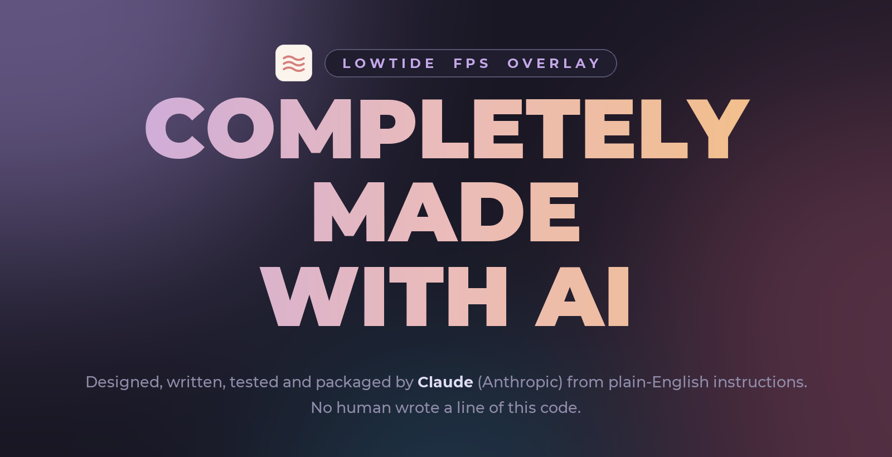
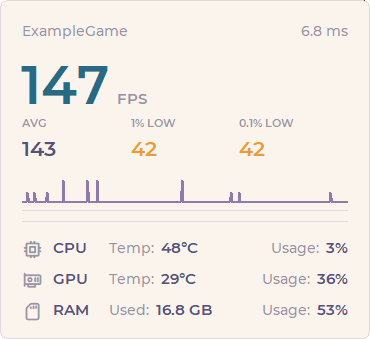
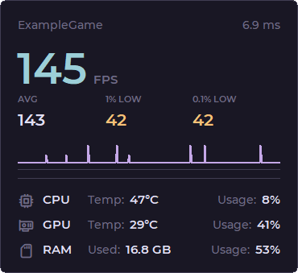
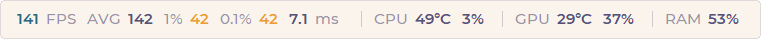
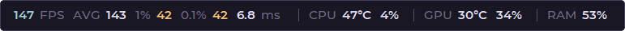
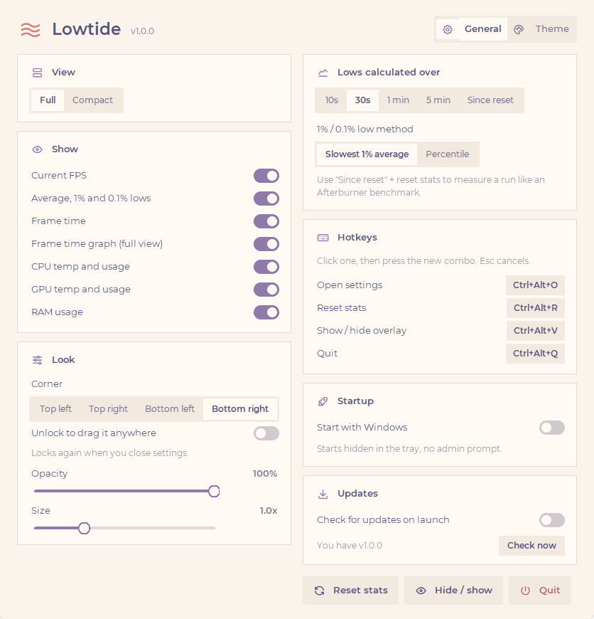
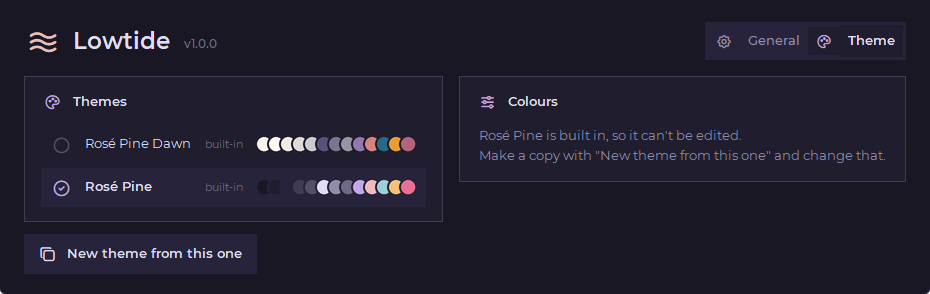
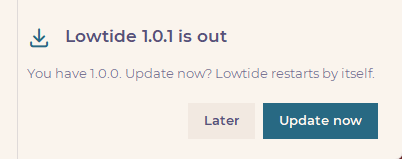

<div align="center">



</div>

<div align="center">

# Lowtide

</div>

<div align="center">

A minimal FPS overlay for Windows with 1% and 0.1% lows, CPU and GPU temps, and RAM usage. It works over fullscreen games  
**Every line of it was written by AI.**

</div>

<div align="center">

[](https://github.com/phsrp/lowtide-fps/releases/latest)  

</div>

## Screenshots

<div align="center">

 









</div>

## What's inside

- **FPS with 1% and 0.1% lows:** current FPS, the average, and the lows, worked out over the last 30 seconds (10 seconds to 5 minutes, or **since you last reset**, like an Afterburner benchmark run). Lows are the average of your slowest 1% / 0.1% of frames, or the 1st / 0.1st percentile if you prefer.
- **Frame time and a frame time graph,** so you can see stutters, not just feel them.
- **CPU and GPU temp and usage** from the sensors everyone quotes: **Core (Tctl/Tdie)** on AMD CPUs (**CPU Package** on Intel), **CPU Total** usage, and **GPU Core** temp and usage.
- **RAM usage:** how many GB are in use and the percentage.
- **Works over fullscreen games:** the overlay never takes focus, so it can't knock a game out of fullscreen, and it keeps itself on top.
- **Full or compact view:** a small card, or every stat on one line.
- **Follows the game you're playing:** stats are for whatever app is in front.
- **Put it anywhere:** pick a corner, or unlock it and drag it where you want.
- **Rebindable hotkeys** (all with Ctrl/Alt, no F keys needed):

  | Hotkey | Does |
  | --- | --- |
  | Ctrl+Alt+O | Settings |
  | Ctrl+Alt+R | Reset stats |
  | Ctrl+Alt+V | Show / hide the overlay |
  | Ctrl+Alt+Q | Quit |

- **Start with Windows** without an admin prompt every time.
- **Updates itself:** it checks for a new version when it starts and asks before installing it.
- **Session log:** when a game closes, its average and lows are saved to `%APPDATA%\Lowtide\logs\sessions.log`.
- **Themes:** Rosé Pine Dawn (light) and Rosé Pine (dark) built in, or make your own in the Theme tab and change any of its 13 colours.
- Montserrat font, [Tabler Icons](https://tabler.io/icons).

## Are the numbers right?

Yes, and they are the same numbers MSI Afterburner / RTSS and HWiNFO show, so you can post them when asking for help.

| Stat | Where it comes from | Same as |
| --- | --- | --- |
| Frame time | PresentMon's `MsBetweenPresents`: the time between two `Present()` calls | RTSS / Afterburner frame time |
| Current FPS | Frames in the last second (sliding 1 s average) | RTSS / Afterburner framerate |
| 1% / 0.1% lows | The slowest 1% / 0.1% of frames in the window you pick | Benchmark lows (say which window and method you used when you post them) |
| CPU temp | **Core (Tctl/Tdie)** on AMD, **CPU Package** on Intel | HWiNFO "CPU (Tctl/Tdie)", Afterburner CPU temperature |
| CPU usage | **CPU Total** (Windows "% Processor Time") | Afterburner CPU usage |
| GPU temp / usage | **GPU Core** | Afterburner GPU temperature / usage, `nvidia-smi` |
| RAM | Total minus available memory | Afterburner RAM usage, Task Manager "In use" |

How it was checked, on a Ryzen 9 9950X and an RTX 4080 Super:

- **Frames:** 15 seconds of Roblox recorded by PresentMon straight to a file and worked out separately, against Lowtide's own numbers at the same time: average 67.4 vs 67.6 FPS (the recordings started a split second apart), 1% low 58.3 vs 58.3, 0.1% low 52.0 vs 52.0.
- **GPU:** within 1°C and a few % of NVIDIA's own `nvidia-smi`.
- **CPU usage:** follows the Windows performance counter. Task Manager can show a bit more, because it counts boost clocks ("% Processor Utility").
- **RAM:** matches Windows exactly.

Each swap chain is tracked on its own, so a game that draws from two (a launcher UI and the game, say) can't double its FPS. Live wallpapers (Wallpaper Engine, Lively) are ignored.

## How to download

1. Open the [latest release](https://github.com/phsrp/lowtide-fps/releases/latest) (the purple **download** button at the top of this page does the same).
2. Under **Assets**, click `Lowtide-Setup-<version>.exe`.
3. Run the file you downloaded and click through the installer. Leave **Start Lowtide with Windows** ticked if you want it there every time.
4. **If Windows says "Windows protected your PC":** the installer is not code-signed yet, so Windows is careful with it. Click **More info**, then **Run anyway**.

Lowtide lives in the **tray** by the clock. Right-click its icon for **Settings** and **Quit**.

It needs administrator rights, because reading frame times (through Windows' event tracing) and CPU temperatures both require them. Windows asks once when you start it. Started with Windows, it doesn't ask.

### CPU temperature

CPU temps need the free [PawnIO](https://pawnio.eu/) driver, the same one LibreHardwareMonitor, FanControl and CleanMeter use. The installer has a ticked **Install the PawnIO driver** box that runs PawnIO's official setup (it only shows up if you don't have PawnIO yet). Everything else works without it.

### Updating

Lowtide checks for a new version every time it starts. When there is one, it asks first, then installs it and restarts by itself. It never asks while a game is running; you get a tray notification instead. You can also click **Check now** in settings.



## What the version numbers mean

Every version is three numbers separated by dots, for example **1.0.1**:

```
  1   .   0   .   1
  │       │       └── minor update: fixes and small improvements
  │       └────────── major update: a big batch of new features (counts from 0 to 9)
  └────────────────── goes up by one when the major number would pass 9
```

- **Minor update (the last number)** goes up for small changes: bug fixes, polish, small additions. `1.0.0` → `1.0.1`.
- **Major update (the middle number)** goes up for a big update with new features, and the minor number starts again from 0. `1.0.1` → `1.1.0`. It counts from 0 up to 9.
- **The first number** only changes when the major number runs out: after `1.9.x` the next big update is `2.0.0`.

So a bigger number on the left always means a newer version: `1.0.1` is newer than `1.0.0`, and `1.1.0` is newer than `1.0.9`.

## Building

Needs Python 3.14 and [Inno Setup 6](https://jrsoftware.org/isinfo.php) (`winget install JRSoftware.InnoSetup`).

```
pip install pyinstaller pystray pillow
powershell -ExecutionPolicy Bypass -File build.ps1
```

`build.ps1` downloads PresentMon, LibreHardwareMonitor and the PawnIO setup, compiles `lib/SensorHelper.cs` with the C# compiler that ships with Windows, builds the exe with PyInstaller and the installer with Inno Setup. The installer lands in `release/`.

To run it from source: `python lowtide.py` (after `build.ps1` has fetched the dependencies once).

## How it works

- [PresentMon](https://github.com/GameTechDev/PresentMon) records the time between every frame each program presents. Lowtide keeps the frames per swap chain and shows the app in front.
- `lib/SensorHelper.exe` is a tiny C# program around [LibreHardwareMonitor](https://github.com/LibreHardwareMonitor/LibreHardwareMonitor) that prints the CPU and GPU readings once a second.
- The overlay is a click-through, always-on-top window that never takes focus. Games running in "fullscreen" on Windows 10 and 11 go through the desktop compositor, so it shows on top. A very old game in true exclusive fullscreen (or one where you turned off fullscreen optimizations) doesn't allow any window on top; the stats are still recorded to the session log.
- "Start with Windows" is a scheduled task that runs at sign-in with admin rights, which is why there's no prompt.

## Built with

- [Python](https://www.python.org/) and Tkinter, packaged with [PyInstaller](https://pyinstaller.org/)
- [PresentMon](https://github.com/GameTechDev/PresentMon) by Intel (MIT) for frame capture
- [LibreHardwareMonitor](https://github.com/LibreHardwareMonitor/LibreHardwareMonitor) (MPL-2.0) for sensors
- [pystray](https://github.com/moses-palmer/pystray) (LGPL-3.0) and [Pillow](https://python-pillow.org/) for the tray icon
- [Inno Setup](https://jrsoftware.org/isinfo.php) for the installer
- [Montserrat](https://github.com/JulietaUla/Montserrat) font (SIL Open Font License)
- [Tabler Icons](https://tabler.io/icons) (MIT)
- [Rosé Pine](https://rosepinetheme.com/) Dawn colours

See [THIRD-PARTY-NOTICES.md](THIRD-PARTY-NOTICES.md) for licences.
